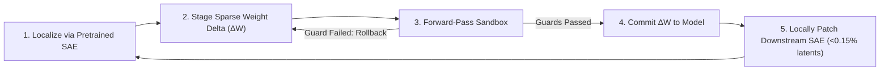

# Metacognitive Weight Editing (`mwe`)

A lightweight harness for closed-loop **Weight-Space Programming** guided by **pretrained Sparse Autoencoders (SAEs)** with **reversible sandbox guards** and **local subspace SAE patching**.

## Core Loop



## Quick Start

```bash
python3 download_models.py   # Downloads GPT-2 Small + Layer 6 & Layer 9 Pretrained SAEs (24,576 latents each)
python3 run_experiment.py    # Runs the full 5-step loop (~22s on Apple M1 Pro)
```

## First End-to-End Run Results (`results/latest_run.json`)

* **Model:** `gpt2` (124,439,808 parameters)
* **Pretrained SAEs:** `jbloom/GPT2-Small-SAEs-Reformatted` (`blocks.6.hook_resid_pre` & `blocks.9.hook_resid_pre`, 24,576 latents each)
* **Step 1 (SAE Feature Localization at Layer 6):**
  * Automatically isolated Latent `#693` ($\text{AUC} = 0.979$) and Latent `#3210` ($\text{AUC} = 0.958$, $92\%$ firing on unverified rumor prompts vs. $0\%$ on verified facts).
* **Steps 2 & 3 (Sandbox Rollback $\rightarrow$ Refinement):**
  * **Attempt 1 ($\theta=2.031$):** Cut practice failure rate $100\% \rightarrow 16.7\%$, but keeper byte-identical rate was $91.7\%$ ($< 95\%$ guard) $\rightarrow$ **automatically rolled back**.
  * **Attempt 2 ($\theta=2.181, g=12.0$):** Cut practice failure rate $100\% \rightarrow 16.7\%$ with **$100.0\%$ byte-identical keepers** and **$0.000010$ collateral KL** $\rightarrow$ **committed**.
* **Step 4 (Held-Out Generalization, 1,537 / 124.4M weights edited = `0.00124%`):**
  * **Held-out Failure Rate:** $100.0\% \rightarrow 40.0\%$ (target abstention token probability rose $0.06\% \rightarrow 58.9\%$).
  * **Held-out Verified Facts Kept:** **$100.0\%$ byte-identical**.
  * **Collateral KL Divergence:** **$0.000010$**.
* **Step 5 (Local Subspace SAE Patch at Downstream Layer 9):**
  * Froze **$99.87\%$** of the Layer 9 SAE dictionary ($24,544 / 24,576$ latents untouched) and updated only the **32 latents (`0.13%`)** aligned with the Layer 6 edit's write subspace and post-edit residual.
  * Reduced post-edit Layer 9 SAE reconstruction MSE by **$41\%$** ($46.80 \rightarrow 27.63$) and improved reconstruction cosine similarity ($0.779 \rightarrow 0.813$) in $<1\text{s}$.
