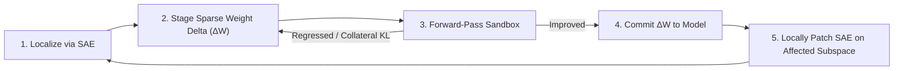

# Metacognitive Weight Editing (`mwe`)

A lightweight harness for closed-loop **Weight-Space Programming** guided by **Sparse Autoencoders (SAEs)** with **local dictionary updates**.

## Core Loop

1. **SAE Feature Localization:** Identify the monosemantic SAE latents that differentially fire on failure cases vs. keeper examples.
2. **Staged Weight Delta ($\Delta W$):** Propose a sparse, low-rank weight edit (e.g., single-neuron gate or directional projection) on CPU without mutating the base checkpoint.
3. **Budgeted Forward-Pass Sandbox:** Run a small diagnostic batch on GPU with $\Delta W$ applied, measuring both target fix rate and collateral drift (KL / MMLU / feature stability) while caching downstream activations.
4. **Commit or Rollback:** Commit $\Delta W$ only when target metrics improve within collateral bounds.
5. **Local SAE Patching:** Freeze $99.9\%$ of the SAE dictionary and update *only* the local SAE latents (or append residual patch latents) that intersect $\text{span}(\Delta W)$ using the cached sandbox activations.

## Structure

- `mwe/loop.py`: Minimal core abstractions (`SparseWeightDelta`, `LocalSAEPatcher`, `WeightEditingSandbox`).
