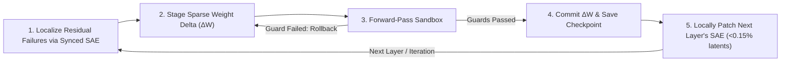

# Metacognitive Weight Editing (`mwe`)

A lightweight harness for closed-loop **Weight-Space Programming** guided by **pretrained Sparse Autoencoders (SAEs)** with **reversible sandbox guards**, **residual failure boosting**, and **local subspace SAE patching**.

## Core Loop



## Quick Start

```bash
python3 download_models.py   # Caches GPT-2 Small + Layers 6..11 Pretrained SAEs (24,576 latents each)
python3 run_experiment.py    # Runs the multi-iteration closed loop across layers
```

## Multi-Iteration Progression (`results/multi_loop_run.json`)

Each iteration queries the current layer's **locally synced SAE** on the remaining unsolved / lowest-confidence practice prompts, stages a 1-neuron MLP gate (`1,537` weights), verifies keeper and KL guards in the sandbox, commits the edit, saves checkpoints to disk, and locally patches `32 / 24,576` (`0.13%`) latents of the next downstream SAE:

| Iteration | Layer Edited (Unit) | Top SAE Latent (AUC) | Cumulative Weights Edited | Practice Failure ↓ | Practice Target Prob ↑ | **Held-Out Failure ↓** | **Held-Out Target Prob ↑** | **Held-Out Keepers Identical** | Collateral KL | Downstream SAE Local Patch (MSE ↓) |
| :--- | :--- | :--- | :--- | :--- | :--- | :--- | :--- | :--- | :--- | :--- |
| **0 (Base)** | — | — | `0` (`0%`) | `100.0%` | `0.05%` | **`100.0%`** | **`0.06%`** | `100.0%` | `0.00000` | — |
| **Iter 1** | Layer 6 (`u1739`) | `#693` (`0.979`) | `1,537` (`0.0012%`) | `16.7%` | `81.8%` | **`30.0%`** | **`62.6%`** | **`100.0%`** | `0.00001` | Layer 7 SAE: `31.5k` $\rightarrow$ `21.0k` (`-33%`) |
| **Iter 2** | Layer 7 (`u2758`) | `#1819` (`1.000`) | `3,074` (`0.0025%`) | **`0.0%`** | `95.6%` | **`20.0%`** | **`75.0%`** | **`100.0%`** | `0.00001` | Layer 8 SAE: `127.6k` $\rightarrow$ `95.3k` (`-25%`) |
| **Iter 3** | Layer 8 (`u583`) | `#18486` (`1.000`) | `4,611` (`0.0037%`) | **`0.0%`** | **`100.0%`** | **`10.0%`** | **`90.0%`** | **`100.0%`** | `0.00002` | Layer 9 SAE: `9.20M` $\rightarrow$ `6.97M` (`-24%`) |

### Persistence on Disk (Original vs. Edited)
* **Untouched Originals (`/tmp/mwe_cache`):** Base `gpt2` (`548 MB`) and all 6 pretrained SAEs (`blocks.6`–`blocks.11`, `151 MB` each) are **never modified on disk**.
* **Saved Iteration Deltas (`/tmp/mwe_runs/checkpoints/`):**
  * `model_delta_iter_1_L6.safetensors` (`19 KB`), `model_delta_iter_2_L7.safetensors` (`37 KB`), `model_delta_iter_3_L8.safetensors` (`56 KB`), `model_delta_final.safetensors` (`56 KB`)
  * `sae_L7_delta_iter_1.safetensors` (`193 KB`), `sae_L8_delta_iter_2.safetensors` (`193 KB`), `sae_L9_delta_iter_3.safetensors` (`193 KB`)
